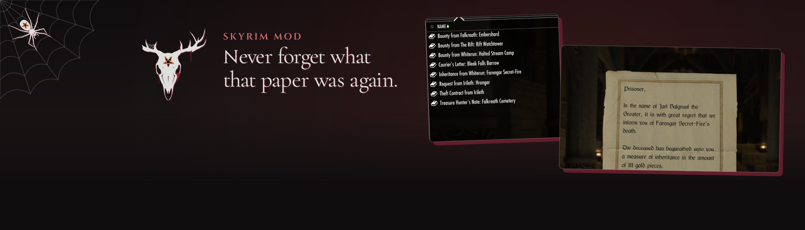
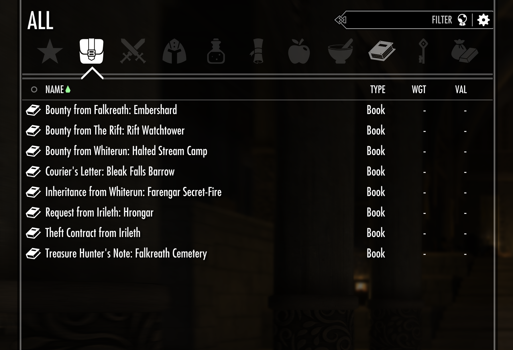
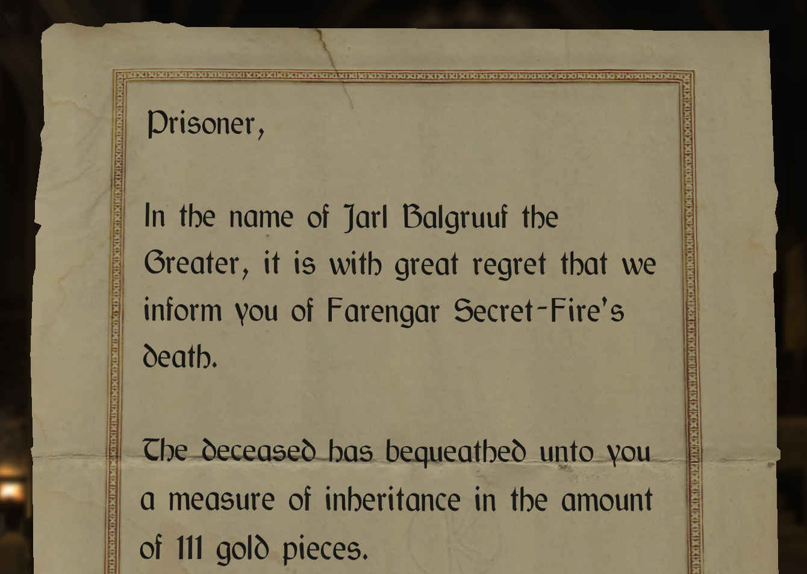
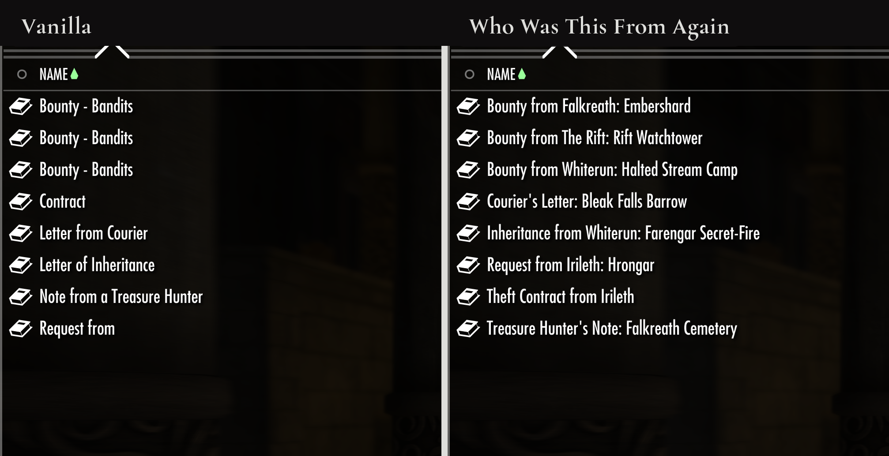
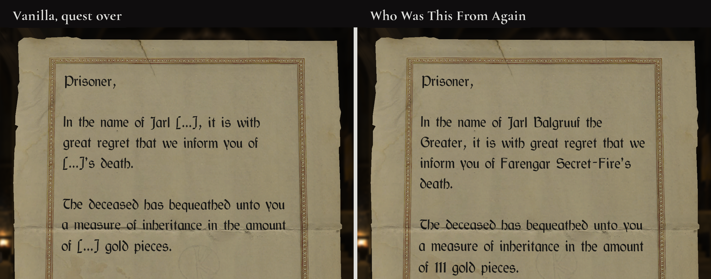

Skyrim reuses one letter for every bounty, inheritance and contract, so they all read the same and you can't tell them apart. This mod gives each copy its own name when it reaches your bag, and keeps what the letter says so it never turns into "[...]".

<picture>
  <source media="(prefers-color-scheme: dark)" srcset="docs/divider.png">
  
</picture>

## How it works

- **Every letter gets its own name.** The kind of letter, who it is from where the game knows it, and what it is about: "Bounty from Whiterun: Halted Stream Camp", "Inheritance from Whiterun: Alvor". The name is set when the letter reaches your bag, so it is right while the quest still knows who and where.
- **The text stays.** In the base game a letter's text turns into "[...]" once its quest ends. The mod saves the text when you pick the letter up and shows it when you read it, whatever has happened to the quest since.
- **Fifteen kinds of letter:** Letter of Inheritance, Letter from a Friend, Bounty from a jarl, steward or innkeeper, Contract, Theft Contract, Bounty carried by bounty hunters, Courier's Letter, Treasure Hunter's Note, Request, Letter from Calcelmo, Urag's Note, and the four Dawnguard letters (Orders, Letter from the Vampire, Incriminating Letter, Assassin's Writ).
- **Nothing in the base game is edited.** The mod changes none of the game's books or quests, so it has no record conflicts with mods that rewrite letter text.

 <i>The bag with the mod: each letter says what it is, who it is from and what it is about.</i>

 <i>The same letter read after its quest has ended: the text is still there.</i>

 <i>Before and after: the same bag, in the base game on the left and with the mod on the right.</i>

 <i>Before and after: the base game's letter once its quest has ended, and the same letter with the mod.</i>

## Install

1. Install with your mod manager.
2. Start the game; the mod names letters as they reach your bag, and the ones you already carry the next time a save loads.

**Needs:** SKSE, Address Library for SKSE Plugins, and the Microsoft Visual C++ 2015-2022 redistributable (x64). For the menu: SkyUI and MCM Helper.

**Tested on:** SE (1.5.97) and AE (1.6.640, 1.6.1170 and 1.7.104).

## Choose what it does

With SkyUI and MCM Helper, open **Who Was This From Again** in Mod Configuration. MCM Helper does not run on 1.6.640; there, or with no menu, use the ini.

The defaults are in `Data\MCM\Config\WhoWasThisFromAgain\settings.ini`. To change them, copy the file to `Data\MCM\Settings\WhoWasThisFromAgain.ini` and edit the copy: its values win and survive a mod update. The game reads the ini at start-up; the menu applies a change at once. `1` is on, `0` is off.

- **Letters of Inheritance** (`bInheritance`, default 1): name them.
- **Bounties** (`bBounties`, default 1): bounty notices from jarls, stewards and innkeepers, and the ones bounty hunters carry.
- **Contracts** (`bContracts`, default 1): contracts and theft contracts.
- **Notes and requests** (`bNotes`, default 1): Letter from a Friend, Courier's Letter, Treasure Hunter's Note, Request, Letter from Calcelmo and Urag's Note.
- **Dawnguard letters** (`bDawnguard`, default 1): Orders, Letter from the Vampire, Incriminating Letter and Assassin's Writ.
- **Show who it is from** (`bShowSender`, default 1): the hold or person in the name.
- **Show the person or place it is about** (`bShowSubject`, default 1): the subject in the name.
- **Name style** (`iStyle`, default 0): 0 is "Bounty from Whiterun: Halted Stream Camp", 1 is "Halted Stream Camp - Bounty (Whiterun)", 2 is "Bounty: Halted Stream Camp".
- **Keep each letter's text** (`bKeepText`, default 1): save the text at pickup and show it when you read, so it never turns into "[...]".
- **Rename letters I have** (menu button): give every letter the mod has named the name your settings ask for.
- **Rename them every time a save loads** (`bReapplyOnLoad`, default 0): do the same as the button at each load. With the ini only, set this to 1 for a new style to reach letters you carry.

## Good to know

- Add it any time. Letters already in your bag are named the next time you load a save, and keep their text from then on, if their quest is still running. Letters whose quest has already ended can't be named: the game has dropped what they need, so they stay as they were. Every new letter you get is named and keeps its text.
- Each copy is its own row in your bag, with the mod and without it: the mod gives the rows names, it does not merge them.
- Removing it from a save in progress has not been tested yet, so keep a save from before you added it.
- Nothing runs every frame. The mod acts when a letter reaches your bag, when a save loads, and when you open a letter.

Build it yourself

- **DLL:** `dll\build.bat` with Visual Studio 2022 Build Tools and xmake; CommonLibSSE-NG comes from `COMMONLIBSSE_NG` or `dll\lib\commonlibsse-ng`. MinHook is vendored in `dll\lib\minhook`.
- **Plugin and scripts:** `plugin\build.ps1` with the Creation Kit's Papyrus compiler, the SkyUI and MCM Helper script sources and the game's `Scripts.zip`; `plugin\make_plugin.py` writes the ESL.
- **Package:** `python scripts\package.py`.

## Report a problem

Post in the Nexus page's Bugs tab with your game version, what you saw, this mod's log and your load order. The log shows what the mod actually did, and the load order shows what else could be changing it. Log: `Documents\My Games\Skyrim Special Edition\SKSE\WhoWasThisFromAgain.log`. Load order: `plugins.txt` in your MO2 profile folder, or in `%LOCALAPPDATA%\Skyrim Special Edition` with other mod managers; on MO2, please add `modlist.txt` from the same folder. Send the log before you start the game again, because each launch replaces it. If the game crashed, also send the crash log from Crash Logger or Trainwreck on Skyrim. Logs and load orders are long, so link a paste site or bring them to [Discord](https://discord.com/invite/sayngwyn); logs can show your Windows username, so use a private report on Nexus if you'd rather.

## More by sayngwyn

Also on [my website](https://sayngwyn.com/projects).

## Credits

- **SKSE team** for SKSE.
- **meh321** for Address Library for SKSE Plugins.
- **CommonLibSSE-NG** for the library it is built on (Ryan-rsm-McKenzie, CharmedBaryon, alandtse and contributors).
- **MinHook** (Tsuda Kageyu) for the hook on the book screen.
- **MCM Helper** (Exit-9B) for the settings menu.
- **SkyUI team** for SkyUI and its mod menu.

---

Made with AI. Claude contributed heavily under my direction: I decided what it does and checked it, and the AI wrote most of the code, its tests and these docs.

## Licence

GPL-3.0 with CommonLibSSE-NG's modding exception (see `LICENSE` and `dll\EXCEPTIONS`); MinHook is BSD-2-Clause (`dll\lib\minhook\LICENSE.txt`). The sayngwyn skull mark and the page art in `docs\` are © sayngwyn, all rights reserved; they are not covered by this project's GPL-3.0 licence and are included only for this page. Forks must remove or replace them.
